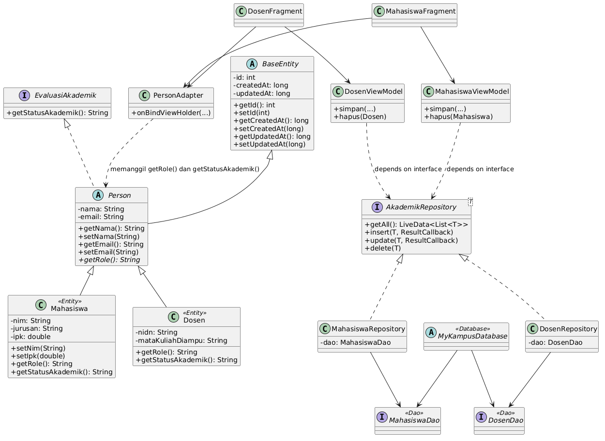

# MyKampus Lite

Aplikasi Android offline untuk manajemen data mahasiswa dan dosen program studi.
Dibuat dengan Java, arsitektur MVVM, dan Room Database.

- **Nama:** (isi nama)
- **NIM:** (isi NIM)
- **Mata Kuliah:** Pemrograman Mobile Lanjut - Java Intermediate

## Fitur

- Tambah, edit (klik item), dan hapus (tekan lama) data Mahasiswa dan Dosen
- Dua tab menggunakan ViewPager2 (Mahasiswa dan Dosen)
- Validasi di level Model: nama minimal 3 karakter, NIM tepat 10 digit, IPK 0.0 - 4.0
- NIM unik, duplikat ditolak
- Status akademik tampil di setiap item daftar
- Data tetap ada saat layar dirotasi

## Arsitektur

```
ui (Activity, Fragment, Adapter)
  -> viewmodel (MahasiswaViewModel, DosenViewModel)
    -> data.repository (AkademikRepository <interface>)
      -> data.dao + data.db (Room)
        -> model (entity)
```

## Penerapan 4 Pilar OOP

| Pilar | Penerapan |
| --- | --- |
| Inheritance | `BaseEntity` (abstract) -> `Person` (abstract) -> `Mahasiswa` dan `Dosen` |
| Encapsulation | Semua field `private`, validasi di setter (`setNama`, `setNim`, `setIpk`) |
| Polymorphism | Interface `EvaluasiAkademik`, diimplementasikan berbeda oleh `Mahasiswa` dan `Dosen`; satu `PersonAdapter` untuk dua tipe |
| Abstraction | Interface `AkademikRepository`, ViewModel hanya bergantung pada interface ini |

## Aturan Status Akademik

Mahasiswa (berdasarkan IPK):

| Kondisi | Status |
| --- | --- |
| IPK > 3.5 | Cumlaude |
| IPK > 3.0 | Memuaskan |
| IPK < 2.0 | Peringatan |
| Lainnya (2.0 - 3.0) | Cukup |

Dosen (berdasarkan jumlah mata kuliah):

| Kondisi | Status |
| --- | --- |
| Lebih dari 3 | Beban Lebih |
| 3 atau kurang | Normal |

## Cara Menjalankan

1. Clone repository ini.
2. Buka di Android Studio.
3. Tunggu Gradle sync selesai.
4. Jalankan pada emulator atau perangkat Android (min SDK 24).

## Pertanyaan Refleksi

### 1. Apa yang terjadi jika constructor kosong pada Entity Room dihapus?

Room membuat objek entity dari hasil query lewat kode yang dibangkitkan saat kompilasi (annotation processing). Untuk itu Room membutuhkan constructor yang bisa diakses. Jika constructor kosong dihapus dan class memiliki constructor lain yang parameternya tidak cocok dengan nama field, proses build gagal dengan error seperti "Entities and POJOs must have a usable public constructor". Room tidak tahu cara membuat objek dari baris tabel. Karena itu, pada `Mahasiswa` dan `Dosen` disediakan constructor kosong, lalu field diisi lewat setter. Untuk constructor selain yang kosong, perlu diberi `@Ignore` agar Room tidak bingung.

### 2. Mengapa ViewModel tidak boleh mengimpor `android.widget.TextView`?

Ada tiga alasan:

1. **Memory leak.** ViewModel hidup lebih lama daripada Activity atau Fragment karena bertahan saat rotasi layar. Jika ViewModel menyimpan referensi ke `TextView`, view lama (dan Activity yang memilikinya) tidak bisa dibersihkan oleh garbage collector.
2. **Pemisahan tanggung jawab.** Dalam MVVM, ViewModel hanya mengelola data dan logic, sedangkan View hanya menampilkan. Jika ViewModel mengenal `TextView`, ia terikat pada satu jenis UI dan batas antar-lapisan menjadi kabur.
3. **Abstraction dan testabilitas.** ViewModel cukup memberi tahu "ada pesan error" lewat `LiveData<String>`, tanpa tahu bagaimana pesan itu ditampilkan (TextView, Toast, atau Snackbar). Dengan begitu ViewModel bisa diuji tanpa perangkat Android dan UI bisa diganti tanpa mengubah ViewModel.

### 3. Contoh nyata Polymorphism yang menghemat baris kode di MyKampus Lite

Pada `PersonAdapter`. Adapter menerima `List<Person>`, lalu menampilkan data cukup dengan:

```java
holder.tvRole.setText(p.getRole());
holder.tvStatus.setText("Status: " + p.getStatusAkademik());
```

Pemanggilan ini sama untuk `Mahasiswa` dan `Dosen`. Objek yang sebenarnya menentukan versi method yang berjalan: `Mahasiswa` menghitung dari IPK, `Dosen` dari jumlah mata kuliah. Tanpa polymorphism, dibutuhkan dua adapter dan dua layout item, atau satu adapter penuh `if (p instanceof Mahasiswa) ... else if (p instanceof Dosen) ...` yang harus diubah setiap ada tipe baru. Dengan polymorphism, satu adapter dan satu layout cukup, sehingga duplikasi kode berkurang. Jika kelak ada tipe baru seperti `Staff`, adapter tidak perlu diubah.

## Class Diagram



## Bonus

- `equals()` dan `hashCode()` pada `Mahasiswa` dan `Dosen`
- `ListAdapter` dengan `DiffUtil` pada `PersonAdapter`
